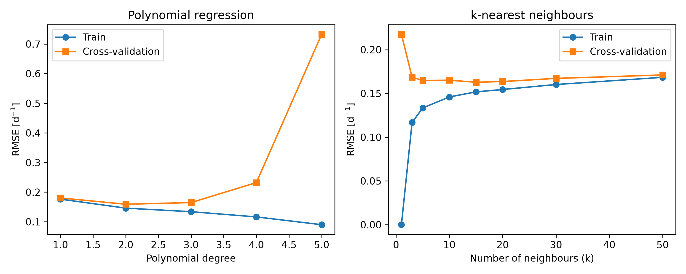
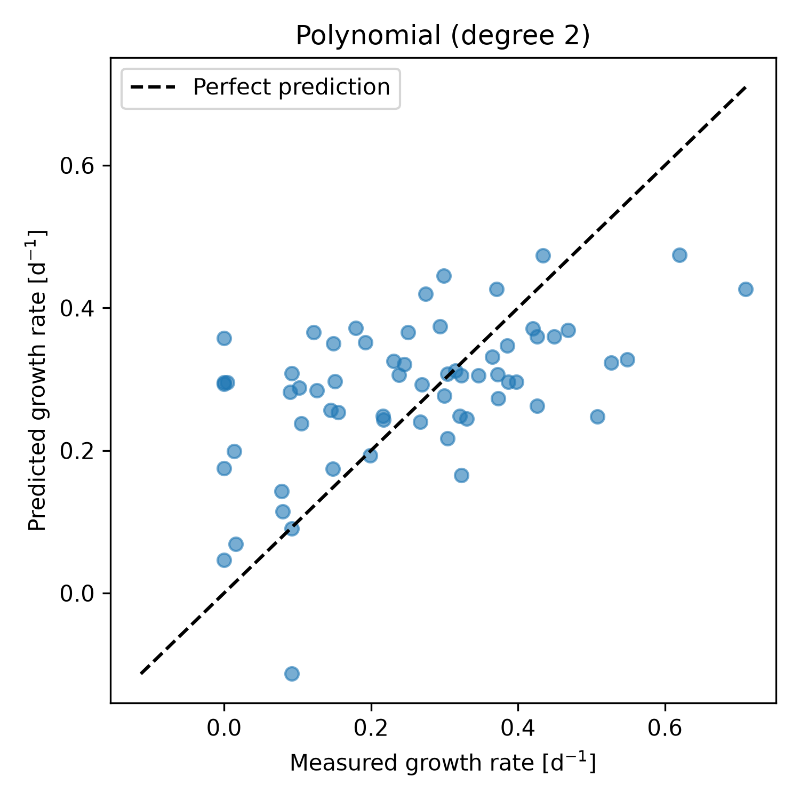
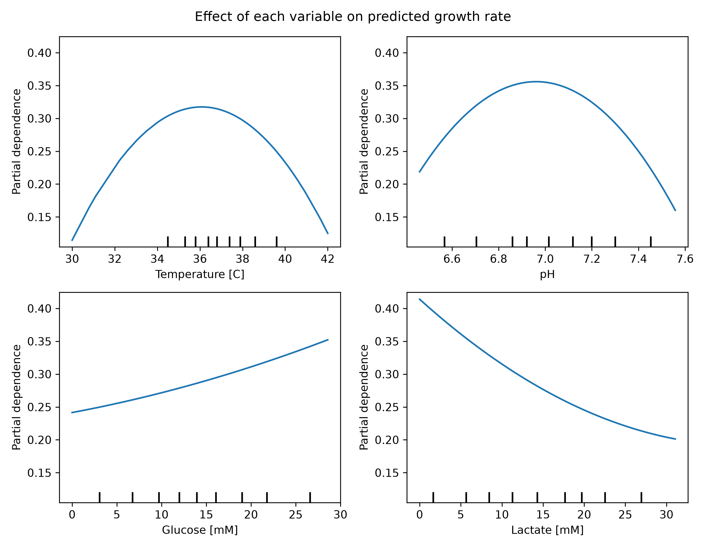

# Repository Structure
# Cell Growth Rate Prediction

This project applies machine learning to estimate cell growth rates based on four essential culture parameters: temperature, pH, glucose and lactate levels. Polynomial and k-nearest neighbours regression models are compared, and amongst them the best-performing is chosen through cross-validation, while also identifying the role of the individual variables. As a result bioprocessing specialists are able to determine optimal conditions for conducting experiments without repeated testing.
## Highlights

- Built a reproducible scikit-learn regression pipeline
- Compared polynomial and k-nearest neighbours regression models
- Tuned hyperparameters using 5-fold cross-validation
- Diagnosed overfitting by comparing training and validation errors
- Visualized process variable effects with partial dependence plots

## Environment

- Python 3.14.7
- matplotlib 3.11.0
- numpy 2.5.2
- pandas 3.0.5
- scikit-learn 1.9.0
## Code Design

When `main.py` is run, the program goes through the entire machine learning procedure by loading the data, creating a separate test data set, testing out many different models of regression, choosing the best one, evaluating it on other data sets, and showing visually how each variable in the process affects the growth rate in question. All paths to files, columns and model values are indicated in `src/constants.py`, while the actual code is located in `src/functions.py`.
### Output Preparation

The program first ensures that there are `figures` and `tables` folders available before analysis starts. All processes after that write all of their results into these folders in the form of PNG and CSV formats. By creating them beforehand, the program is able to continue to run on a new repository without any errors, making sure that all of the results will be stored in the documented source where they can be analyzed or referred to in this paper.
### Data Loading

The data file `datasets/dataset_cell_growth_4factor.csv` is imported into a pandas DataFrame. At this point, a statistical description, including the count, mean, standard deviation, minimum, quartiles, and maximum for each variable is displayed. This step is meant to serve as a quality check of the data: it assures us that all 318 data points entered correctly, and there are no missing values. Moreover, the summary indicates the scope of the experiments (in terms of temperature for example, 30 to 42 °C in this example). This scope is of utmost importance as the model must be used solely within the region where it was trained on the data.
### Train/Test Split

The above-mentioned four input variables (temperature, pH, glucose concentration and lactate concentration) are isolated from the expected outcome of the specific growth rate. Data is divided randomly into an 80% training set and a 20% testing data. The division is done with a fixed random seed so that this division and hence all the outcomes of the work in this paper could be replicated. The reason of doing this is that an honest assessment of the results of the model should be based on data the model has not seen before. The testing set is closed off and used only once at the end of the process for testing in order to estimate the expected performance of the model.
### Candidate Model Construction

In this study, two distinct sets of regression models are developed: one involving polynomial regression with degrees ranging from 1 to 5, and the other using *k*-nearest neighbors (KNN) regression with *k* varying from 1 to 50. To implement these models, the researchers adopt scikit-learn pipelines with the help of a standard scaler. This scaling is essential because the predictors are measured in different units and have different values: for example, pH has a range within one unit while glucose and lactate are measured in mmolar. Without scaling, the distances calculated using KNN would be heavily influenced by the predictors with the largest values; similarly, the polynomials would behave improperly in their calculations.
### Cross-Validated Model Comparison

All candidate models are assessed through 5-fold cross-validation on the training sample. The training set will be split into 5 segments; in one of the segments the model will be evaluated while the other 4 will be used for the training process, this process is repeated after the evaluation of the model on every segment of data. The pair of training RMSE, validation RMSE, and validation R² is retained for each model. The comparison of training and validation results allows for the identification of the underfitting/overfitting problem. The results are sorted by validation criteria, saved to the file `tables/model_comparison.csv`, and provided in the figure `figures/model_comparison.png`. This point of the procedure is crucial, as could provide a proof for a choice of model and hyperparameters.

### Model Selection and Final Evaluation

The correlation was made that the model with the minimum mean cross-validation RMSE is automatically chosen. It goes through retraining on the complete training dataset and the growth rate of the test set is predicted. The test RMSE, mean absolute error, and R² are saved in `tables/test_metrics.csv` and a parity plot with the measured and predicted values is generated and saved in `figures/parity_plot.png`. This confirms that the performance shown in the cross-validation is applicable to unseen data.
### Feature Effect Analysis

In conclusion, partial dependence plots are produced for each of the four variables used in the process, and these plots are stored in the “figure/feature_effects. png”. Partial dependence plot describes how the value of the predicted growth rate is affected by a specific variable, while the average influence of the other variables is taken into account. In this way, the trained model changes from a black-box predictor to an analytical tool to understand the process.

## Analysis

### Model Selection

The selected model is a second-degree polynomial regression applied to standardized inputs. With four input variables, this model contains 15 terms: an intercept, the four linear terms, four squared terms and six pairwise interaction terms (for example, temperature × pH). The coefficients are fitted by ordinary least squares, without regularization. The inputs are standardized before the polynomial expansion so that all variables contribute on a comparable scale, regardless of their original units.

This architecture was chosen because it achieved the lowest mean cross-validation error of all 13 candidate models, and because its structure matches what is known about cell biology. Growth rate is expected to peak at an optimal temperature and an optimal pH, and to decrease on either side of that optimum. A linear model cannot represent such a peak, while a quadratic term naturally produces a curve with a single maximum. The interaction terms also allow the effect of one variable to depend on the level of another, which is realistic in a living culture.

### Comparison with Alternatives

Using the training set, thirteen different models were tested using the 5-fold cross-validation method. These models include polynomial regression with degrees ranging from 1 to 5 as well as the k-nearest neighbour method with k values ranging from 1 to 50. All the results can be found in `tables/model_comparison.csv`, some of which are shown in the table below.
| Model | Train RMSE | CV RMSE | CV RMSE Std | CV R² |
|---|---|---|---|---|
| Polynomial (degree 1) | 0.1764 | 0.1804 | 0.0053 | 0.1128 |
| **Polynomial (degree 2)** | **0.1460** | **0.1592** | **0.0164** | **0.3022** |
| Polynomial (degree 3) | 0.1340 | 0.1648 | 0.0131 | 0.2614 |
| Polynomial (degree 4) | 0.1164 | 0.2323 | 0.0374 | -0.5031 |
| Polynomial (degree 5) | 0.0901 | 0.7331 | 0.1850 | -14.5689 |
| KNN (k = 1) | 0.0000 | 0.2177 | 0.0242 | -0.3176 |
| KNN (k = 5) | 0.1334 | 0.1648 | 0.0151 | 0.2521 |
| KNN (k = 15) | 0.1518 | 0.1628 | 0.0054 | 0.2782 |
| KNN (k = 50) | 0.1684 | 0.1711 | 0.0037 | 0.2029 |

The results obtained for polynomial regression illustrate the classic bias–variance trade-off. The linear model (degree 1) produces equal training errors and validation errors, which are high since it cannot represent optimally the data. The increasing degree to 2 reduces both errors. After degree 2, the training errors keep decreasing while the validation errors increase. At degree 4 and 5, validation R² is negative, meaning that the model became worse than predicting the mean growth rate. However, there teachers 70 parameters at degree 4 and 126 parameters, and given that there are about 200 instances in total for training each model, this over-fits noise instead of representing data patterns well.

KNN also demonstrates bias–variance trade-off but in the opposite manner. With k = 1, the method completely memorizes the training set (training RMSE equals zero) while it performs poorly for other sets. Using k = 50 leads to a very smooth model since prediction is made on a huge number of neighbours.
The best KNN model (k = 15, CV RMSE = 0.1628) performs almost as well as the second-degree polynomial (CV RMSE = 0.1592). The difference of 0.0036 is smaller than the standard deviation across folds, so the two models cannot be considered significantly different in accuracy alone. The polynomial model was preferred for three reasons:

1. **Interpretability.** In terms of interpretability, while the polynomial model has a formula that is simple (having 15 coefficients) with smooth response curves that enable the clear identification of optimum pH and temperature values, KNN does not have a defined formula. KNN utilizes lot of samples in every prediction, because KNN does not have a single mathematical formula for prediction. 
2. **Efficiency.** The polynomial model has to only store its coefficients to perform predictions, whereas KNN has to store the whole training data.
3. **Biological Consistency.** The quadratic nature of KNN is expected in the nature of cell growth.

However, it should be noted that in spite of the more complex nature of KNN, KNN is more stable across folds, with the standard deviation of 0.0054 compared to 0.0164 (as indicated in Table 5.2).
### Final Model Performance

Once the selection of the model is completed, the model was trained on full training set again and tested on the prescribed testing set. 

| Model | Test RMSE | Test MAE | Test R² |
|---|---|---|---|
| Polynomial (degree 2) | 0.1455 | 0.1173 | 0.2214 |

The RMSE in the test set was found to be 0.1455, which is comparable to the RMSE obtained through cross-validation which was 0.1592, indicating no overfitting of the model during training but some predictability. The R² value was found to be only 0.22, indicating that the model is able to explain only 22% of the change in the growth rate. The error in the results is about 0.12-0.15 d⁻¹, which can be viewed as a large error if compared with the growth rate of 0.28 d⁻¹. Thus, even though the model does good in recognizing patterns and trends, it fails to provide accurate results for predicting the growth rate of the particular culture.
### Advantages and Limitations

The advantages of the model are its straightforwardness, its interpretability and its steady generalization. The model can be trained quickly, does not need any special equipment and can be compared with biological facts. The use of cross validation and independent testing gives assurance that the results are real.

There exist also a number of limitations:

- **Symmetry of response curves.** The presence of quadratic terms leads to the same parabolic shape of the curves. In cells, the growth drops more sharply above than below the optimal temperature due to denaturation of proteins. The model does not take into account the asymmetrical nature of those curves.
- **Absence of saturation.** In biology, glucose utilization has Monod kinetics meaning that there is a maximum growth at certain concentration of glucose and further increase in its concentration does not lead in further increase in growth. The model assumes continuous increase in growth.
- **Unbounded prediction.** There are no limitations for polynomials. An example on the parity plot shows the model prediction of -0.11 d⁻¹ which is impossible in reality.
- **Return to the average.** The model fails to accurately respond to high growth rates (over 0.6 d⁻¹) and overestimates the growth rates of the cultures without growth at 0.05-0.36 d⁻¹.- **Restricted variation explained.** A significant part of the variability of the growth rate remains unexplained by the four variables in square form. This can be attributed to noise associated with the experiments, intricate relationships between different parameters, or disregarded aspects.

### Influence of Process Variables

According to the partial dependence graph seen above, we can see the impacts that the variables produce over the predicted growth rate when the remaining variables are averaged out.

- **Temperature** has a definite optimum of around 36 °C, yielding a predicted growth rate of around 0.32 d⁻¹. Growth rate drops to about 0.12 d⁻¹ at both 30 °C and 42 °C. Low temperatures impede the rate of enzymatic processes, while high temperatures lead to thermal stress and damage to proteins.
- Similar to temperature, **pH** has an optimum value, which is approximately equal to pH 7.0, generating a predicted growth rate of around 0.35 d⁻¹. Both directions from the optimum reduce the growth so that the cells have to spend energy to maintain their internal pH and carry out enzymatic processes.
- **Glucose** plays a positive role in the process studied here. Its impact can be seen in the predicted growth rate that increases from around 0.24 d⁻¹ without glucose to around 0.35 d⁻¹ at 30 mM glucose concentration.- **Lactate** has a negative effect. The predicted growth rate falls from about 0.41 d⁻¹ without lactate to about 0.20 d⁻¹ at 30 mM. Lactate is a metabolic byproduct that inhibits growth as it accumulates in the culture.
-   **Lactate** produces a negative effect as it reduces the predicted growth rate from around 0.41 d⁻¹ to around 0.20 d⁻¹ at a concentration of 30 mM. Lactate is a metabolite produced through the metabolism of glucose but has been shown to have an inhibitory effect with its accumulation in the culture.

Temperature and pH can show the strongest effects due to the much wider range of response curves produced by them. Lactate also shows a significant effect while glucose demonstrates the smallest effect among the four variables.

### High and Low Growth Conditions

The growth model predicts that a **high specific growth rate** is achieved under conditions of temperature near 36 °C, pH close to 7.0, high glucose concentration, and low lactate levels. Under that set of conditions, you obtain a healthy culture in its early growth period, as it still has plenty of nutrients and has not yet accumulated system’s byproducts.

On the other hand, **low specific growth rate** occurs when temperature and/or pH are not optimal, glucose is scarce or lactate is produced. It is characteristic of late batch culture and failure in process control. The effects are additive: the culture growing in suboptimal temperature and rich in lactate is expected to have very low growth rates.
### Conditions Where Predictions Are Unreliable

The situations in which the model is not credible are as follow:

-  **Under training conditions.** The model is developed with temperatures between 30 and 42°C, glucose and lactate concentration between 0 and 40 mM, and limited pH values. Though out of its scope these quadratic functions run systematically and make unrealistic or negative predictions.
-  **Growth near zero.** As shown in the parity plot all the cultures that have not grown are overestimated. The model fails to predict phenomena in which growth completely stops.
-  **Very high values of growth.** The growth rates above 0.6 d-1 are constantly underestimated.
-  **Uncommon situations.** Areas of rare training data such as high temperature and high lactate together in one case showed small predictions reliability.

### Applications

While the model may not quite represent an exact description of the growth of individual cultures, it is well-regarded for the delineation of trend analyses that could involve decision-making: 
- **Process design.** The model could be used to screen operating conditions suitable for successful laboratory trials, hence guiding engineers to focus work around the most promising temperature and pH setpoints.
- **Feeding strategies.** Glucose stimulates growth, and lactate demonstrates inhibitory characteristics; therefore, the model supports fed-batch strategies in which glucose supply is continuous while limiting lactate accumulation. 
- **Process monitoring.** If such deviations appear, the operators can regard that an unfamiliar occurrence is taking place within the culture, mean that contamination has occurred or equipment-related issues might appear.
- **Experimental planning.** Of course, less reliable areas for the model indicate where further investigations should be performed. As a resultual outcome, the process of gathering more data from extreme conditions and very low growth levels would give surfacy to future versions of the model while allowing other considerable approaches to explore, like mechanistic growth or those based on decision trees.